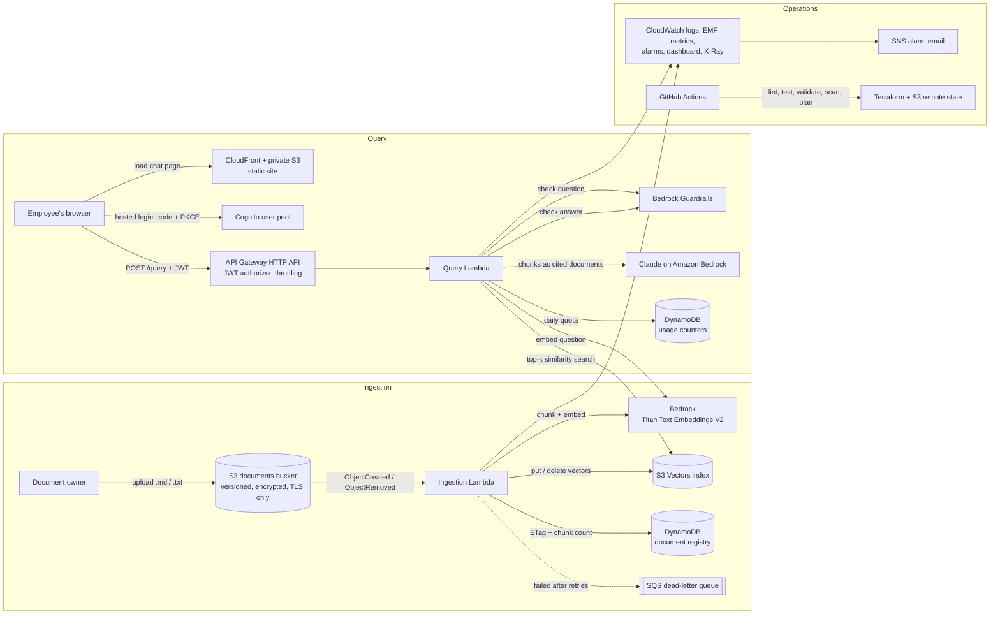

# Enterprise AI RAG Platform on AWS

A serverless retrieval-augmented generation (RAG) platform. Employees sign in to a web chat, ask questions in plain English, and get short answers grounded in internal documents, with citations to the exact passages. Everything is defined in Terraform and checked in CI.


## The problem

Policies, runbooks and onboarding guides are spread across wikis and drives. People spend time searching, support teams answer the same questions repeatedly, and generic chatbots make up answers because they have never seen the company's documents.

## What this platform does

- **Ingests documents automatically.** Dropping a Markdown or text file into S3 triggers chunking and embedding. Editing or deleting the file updates or removes its vectors.
- **Answers from the documents only.** Each question is embedded, the closest chunks are found with vector search, and Claude answers using only those chunks.
- **Shows its sources.** Every answer comes with citations that point to the document, the chunk and the exact sentence used.
- **Says "I don't know".** If nothing relevant is found, it says so instead of guessing.
- **Has a web chat.** A static page on CloudFront with Cognito's hosted login, clickable citations, and a rate-limited demo account for visitors.
- **Is secured and observable.** Cognito sign-in, Bedrock Guardrails on input and output, least-privilege IAM, alarms, a dashboard and tracing.

## Architecture



### How a question is answered

1. API Gateway rejects the request unless it carries a valid Cognito JWT. It also throttles traffic, which caps spend. Accounts in the `demo` group also have a daily question quota, counted in DynamoDB.
2. The query Lambda checks the question with a **Bedrock Guardrail**. Prompt-injection attempts, harmful content and secrets are blocked before any model sees them.
3. The question is embedded with **Titan Text Embeddings V2**. **S3 Vectors** returns the 5 closest chunks, and chunks further than a cosine-distance threshold are dropped.
4. If nothing relevant remains, the API answers "not found" without calling the language model, so these requests cost almost nothing.
5. Otherwise each chunk is sent to **Claude on Amazon Bedrock** as a separate document with citations enabled. The system prompt tells Claude to answer only from those documents and to treat their text as data, not instructions.
6. The answer goes through the guardrail a second time, which masks or blocks PII. The response carries the answer, citations, sources, the model used and token usage.

### How a document is ingested

S3 sends an event to the ingestion Lambda, which:

1. Compares the file's ETag and the current chunking and embedding settings with the DynamoDB registry, and skips files that haven't changed.
2. Splits Markdown at its headings so each section becomes its own chunk, labeled with the document and section title. Long sections are split further into 150-word windows with a 30-word overlap. Then it embeds each chunk.
3. Writes the vectors with deterministic keys, so a re-upload overwrites the old vectors in place.
4. Deletes the vectors for chunk numbers that no longer exist when a document gets shorter. Deleting a file removes all of its vectors.
5. Retries failures twice, then sends them to a dead-letter queue, which raises an alarm.

## Tech stack

| Layer | Service | Why this choice |
|---|---|---|
| Infrastructure as code | Terraform (modules, S3 remote state with native locking) | Repeatable environments, reviewable changes |
| Document storage | Amazon S3 | Versioned, encrypted, event source for ingestion |
| Embeddings | Amazon Titan Text Embeddings V2 (Bedrock) | Managed, 1024-dimension normalized vectors |
| Vector store | Amazon S3 Vectors | Pay per use with no idle cluster cost, a good fit for RAG at this scale |
| Generation | Claude on Amazon Bedrock: Haiku 4.5 by default, Opus 5.5 with one setting | Grounded answers with native citations; stays inside the AWS account boundary |
| Safety | Amazon Bedrock Guardrails | Prompt-attack, content and PII filters on input and output |
| API | API Gateway HTTP API + Cognito JWT authorizer | Authenticated, throttled, access-logged |
| Compute | AWS Lambda (Python 3.13, arm64) | Serverless, scales to zero |
| Registry | DynamoDB (on demand, PITR) | Idempotent ingestion and clean deletes |
| Observability | CloudWatch Logs, EMF custom metrics, alarms, dashboard, X-Ray, SNS | Tokens, latency, no-answer rate, guardrail blocks |
| CI | GitHub Actions: ruff, pytest, terraform validate, Checkov, terraform plan via OIDC | No long-lived AWS keys in CI |

## Repository layout

```
frontend/              chat page: index.html, app.js, styles.css (no build step)
app/
  rag_core/            shared code: chunking, embeddings, vector keys
  ingestion/handler.py S3 event -> chunks -> embeddings -> S3 Vectors
  query/handler.py     guardrail -> retrieval -> Claude with citations -> guardrail
terraform/
  bootstrap/           state bucket + GitHub OIDC plan role (applied once)
  environments/dev/    wires the modules together
  modules/             s3, vectors, dynamodb, auth, guardrail, iam, lambda, apigateway, monitoring, frontend
tests/                 unit tests with fake AWS and Claude clients
eval/                  15-question evaluation set and scoring script
scripts/               build, upload, create user, get token, query, re-ingest
sample-docs/           five fictional company documents to try it with
docs/                  architecture notes, interview guide, video script
```

## Deploy it

### Prerequisites

- An AWS account and the AWS CLI configured with admin credentials for the deployment.
- Terraform 1.10 or later, Python 3.13 or later, `jq`.
- **Bedrock models:** Titan Text Embeddings V2 and Claude Haiku 4.5 are on by default for most accounts. Check by opening Claude Haiku 4.5 in the Bedrock console playground (Model catalog) and sending a message. See [Choosing the Claude model](#choosing-the-claude-model) to use Opus 5.5 instead.

### 1. Create the state bucket (once per account)

```bash
cd terraform/bootstrap
terraform init
terraform apply -var="github_repository=gkoufie1/enterprise-ai-rag-platform"   # omit the variable to skip the CI plan role
```

### 2. Build and deploy

```bash
bash scripts/build_lambdas.sh                        # Lambda packages for Linux arm64

cd terraform/environments/dev
cp backend.hcl.example backend.hcl                   # set the bucket from step 1
cp terraform.tfvars.example terraform.tfvars         # set alarm_email, allowed_origins
terraform init -backend-config=backend.hcl
terraform plan -out=tfplan
terraform apply tfplan
```

Confirm the SNS subscription email so alarms reach you.

### 3. Load documents and open the web app

```bash
bash scripts/upload_docs.sh                          # ingestion starts automatically

export RAG_PASSWORD='Choose-a-Strong-Passw0rd!'
bash scripts/create_user.sh you@example.com          # your own account, no daily limit
terraform -chdir=terraform/environments/dev output -raw frontend_url
```

Open the URL, choose **Sign in**, and use the account you just created. CloudFront can take a few minutes to start serving a new distribution.

### 4. Or call the API from the terminal

```bash

export RAG_TOKEN="$(bash scripts/get_token.sh you@example.com)"

bash scripts/query_api.sh "Can I use my personal laptop for customer data when working remotely?"
```

Example response:

```json
{
  "question": "Can I use my personal laptop for customer data when working remotely?",
  "answer": "No. Remote work must be done on a company-managed laptop, and personal devices may not be used to access customer data...",
  "citations": [
    {
      "document_key": "remote-work-policy.md",
      "chunk_index": 0,
      "cited_text": "Personal computers, tablets and phones may not be used to access customer data."
    }
  ],
  "sources": [{ "document_key": "remote-work-policy.md", "chunk_index": 0, "distance": 0.31 }],
  "model": "anthropic.claude-haiku-4-5-20251001-v1:0",
  "usage": { "input_tokens": 1149, "output_tokens": 54 },
  "remaining_questions_today": null
}
```

(Illustrative; your text, distances and token counts will differ.)

## Choosing the Claude model

The query function can reach Claude through either of Bedrock's two endpoints, chosen with `claude_endpoint`:

| Setting | Default | Notes |
|---|---|---|
| `claude_endpoint = "runtime"`, `claude_model_id = "us.anthropic.claude-haiku-4-5-20251001-v1:0"` | Yes | Classic `bedrock-runtime` InvokeModel through a US cross-region inference profile. Available to most accounts. Fast and inexpensive. |
| `claude_endpoint = "mantle"`, `claude_model_id = "anthropic.claude-opus-5-5"` | No | Claude in Amazon Bedrock (Messages API). Adds the `effort` setting and an automatic refusal fallback (`fallback_model_id`). |

AWS enables its newest models per account, based on account age and usage history, so a new account can get "model is not available for this account" for Opus while Haiku works. This project runs on Haiku 4.5 by default for that reason. To upgrade once your account has access, set the three `mantle` values shown in `terraform.tfvars.example` and run `terraform apply`. The IAM policy switches to the matching permission automatically, and the code, citations and front end don't change.

## Web app and public demo account

The chat page lives in `frontend/` as three static files with no build step. Terraform uploads them to a private S3 bucket served only through CloudFront, and generates `config.js` with the API URL and Cognito settings.

- **Sign-in:** Cognito's hosted login page, using the authorization-code flow with PKCE. The browser never handles a client secret, and tokens are kept in `sessionStorage`.
- **Answers:** each answer shows its cited passages under a "sources cited" toggle, plus a badge when the guardrail blocked something.
- **Safe rendering:** API text is inserted with `textContent`, and CloudFront adds a strict Content-Security-Policy and other security headers.

To let visitors (for example, recruiters) try it without giving out a personal account:

```bash
export RAG_PASSWORD='Demo-Passw0rd-2026!'
bash scripts/create_user.sh demo@example.com demo    # joins the "demo" group
```

Then set `demo_login_hint` in `terraform.tfvars` (for example `"Email: demo@example.com   Password: Demo-Passw0rd-2026!"`) and apply again; the sign-in page shows it. Everyone using the demo login shares `demo_daily_limit` questions per day (default 30), so the worst-case cost is roughly 30 answers a day, about 10 cents with Haiku 4.5. Regular accounts are unlimited unless you set `user_daily_limit`.

To run the page locally, copy `frontend/config.example.js` to `frontend/config.js`, fill it in from `terraform output`, run `python -m http.server 3000` in `frontend/`, and open http://localhost:3000/.

## Evaluation

`eval/questions.jsonl` holds 15 cases: 12 answerable questions with the document that should be cited and keywords the answer must contain, 2 questions the documents can't answer (the system should abstain), and 1 prompt-injection attempt (the guardrail should block it).

```bash
export RAG_API_URL="$(terraform -chdir=terraform/environments/dev output -raw query_api_url)"
python eval/run_eval.py
```

It reports retrieval hit rate, citation accuracy, keyword accuracy, correct abstentions and blocked attacks, then writes `eval/results.json`. Re-run it after changing the chunk size, `top_k`, the distance threshold, the model or the prompt, and compare.

### Results on the deployed system (Claude Haiku 4.5)

| Version | Passed | Retrieval | Citation | Keywords | Abstained correctly | Injection blocked |
|---|---|---|---|---|---|---|
| Fixed 250-word chunks, cutoff 0.75 | 12 / 15 | 9 / 12 | 9 / 12 | 9 / 12 | 2 / 2 | 1 / 1 |
| **Section-aware chunks, cutoff 0.70** | **15 / 15** | **12 / 12** | **12 / 12** | **12 / 12** | **2 / 2** | **1 / 1** |

The first run failed three questions that never reached the model. Each short document had become a single chunk, so a narrow question ("How long do we keep audit logs?") was a weak match for a document covering five topics, and the search ranked the wrong document first. Splitting at Markdown headings gave each topic its own embedding: the cosine distance of the right section fell from 0.76–0.86 to 0.42–0.59, while unanswerable questions stayed at 0.79 or more. That gap is why the cutoff moved to 0.70. Answers took about 1.5 seconds; abstentions and blocks about 0.5 seconds.

The guardrail also needed tuning on the live system: at the strictest setting its misconduct filter blocked "Can I use my personal laptop to look at customer data?", a normal policy question, so that filter now runs at medium strength.

## Testing and CI

```bash
pip install -r requirements-dev.txt
ruff check . && pytest
```

The unit tests replace AWS and Claude with in-memory fakes. They cover chunking, idempotent re-ingestion, stale-vector cleanup, deletes, citation mapping, the distance filter, both guardrail checks, refusals and request validation and the daily demo quota.

On every push and pull request, GitHub Actions runs:

1. ruff and pytest.
2. `terraform fmt` and `validate` for both stacks.
3. A Checkov security scan of the Terraform.
4. `terraform plan` against the real account, using a read-only role assumed through GitHub OIDC with no stored keys. This job runs once the repository variables `AWS_PLAN_ROLE_ARN` and `TF_STATE_BUCKET` are set from the bootstrap outputs.

## Security

- **Authentication:** Cognito JWT authorizer on the only route. Self sign-up is off, the password policy is strong, and optional TOTP MFA is available.
- **Least privilege:** one IAM role per function, scoped to its own log group, bucket, table, vector index, embedding model and guardrail.
- **Data protection:** encryption at rest everywhere, a bucket policy that denies non-TLS requests, S3 Block Public Access, versioning, and DynamoDB point-in-time recovery.
- **AI safety:** guardrails on input and output; the prompt treats documents as data; answers come only from retrieved context and abstain otherwise; a refusal fallback keeps users from getting an empty answer.
- **Abuse and cost control:** API throttling (5 requests per second, burst 10), a daily question quota for demo accounts, a 1,000-character question limit, and a cap on output tokens.
- **Web app:** private S3 origin behind CloudFront with origin access control, HTTPS only, Content-Security-Policy, HSTS and anti-framing headers. The demo login can't change its own password, because the web client's tokens don't carry the account-management scope.
- **Auditability:** API access logs with the caller's identity, structured query logs, and X-Ray traces.

## Cost

With no traffic the platform costs close to nothing, because every component is serverless and billed per use. Expect roughly 0 to 3 USD per month, mostly CloudWatch, and less within the free tiers.

| Item | Approximate cost |
|---|---|
| Claude Haiku 4.5 answer (about 2,000 input and 150 output tokens) | about 0.3 cents per question; check Bedrock pricing for your region |
| Claude Opus 5.5 answer instead, if enabled | about 1 to 2 cents per question |
| Titan embeddings, S3 Vectors queries, guardrail checks, Lambda, API Gateway | well under 0.1 cent per question |
| Questions with no relevant documents | no Claude call, so close to zero |
| Storage (S3, S3 Vectors, DynamoDB) for the sample documents | cents per month |
| CloudFront and the static site | free tier covers a demo (1 TB and 10 million requests per month) |

Ways to reduce cost: lower `top_k` or tighten `max_distance`.

## Design decisions

- **Why S3 Vectors rather than OpenSearch Serverless:** OpenSearch Serverless has a minimum always-on capacity charge. S3 Vectors bills only for storage and queries, which fits a knowledge base that is queried occasionally. At hundreds of sustained queries per second, OpenSearch would be the better choice.
- **Why not Bedrock Knowledge Bases:** the managed service would replace most of the ingestion code. Building the pipeline by hand shows how chunking, embedding, idempotency and deletes actually work, and keeps every step testable. Moving to Knowledge Bases later is straightforward.
- **Why citations instead of asking for sources in the prompt:** native citations return the exact cited text with an index pointing to the source document. That is verifiable, while sources the model writes into its answer can be invented.
- **Why Haiku 4.5 by default:** short, document-grounded answers don't need the largest model. Haiku is fast, well inside API Gateway's 30-second limit, and inexpensive enough to leave a public demo running. The endpoint setting keeps Opus one change away.
- **Why low effort on Opus:** the same reasoning; lower effort cuts latency when the `mantle` endpoint is used.

## Limitations and next steps

- Only `.md` and `.txt` files are ingested; PDF and Word files would need a text-extraction step (for example Amazon Textract or a PDF library).
- One knowledge base for everyone. Per-department access control could filter vector search on a metadata field that maps to Cognito groups.
- Single-turn questions with no conversation memory.
- The site uses the default `*.cloudfront.net` address; a custom domain needs an ACM certificate and a DNS record.
- Answers are not streamed. Streaming would need Lambda response streaming or WebSockets instead of the HTTP API.

## Clean up

```bash
cd terraform/environments/dev && terraform destroy
```

Set `force_destroy = true` first if the buckets still hold data. The state bucket in `terraform/bootstrap` is protected from deletion on purpose.
