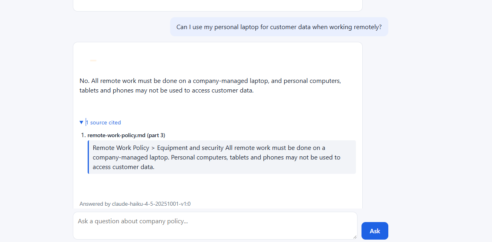
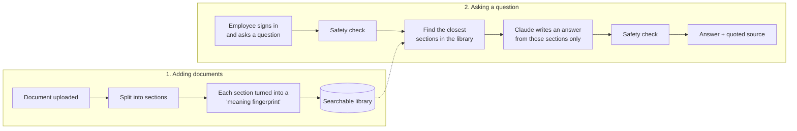
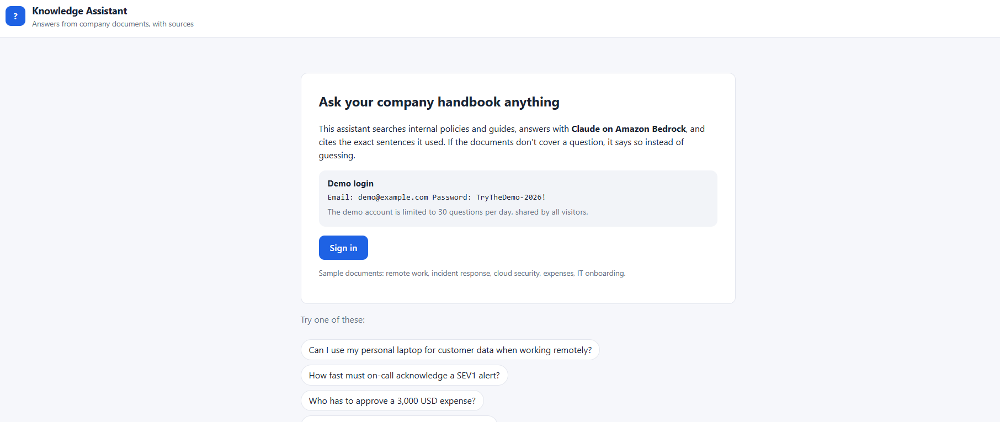
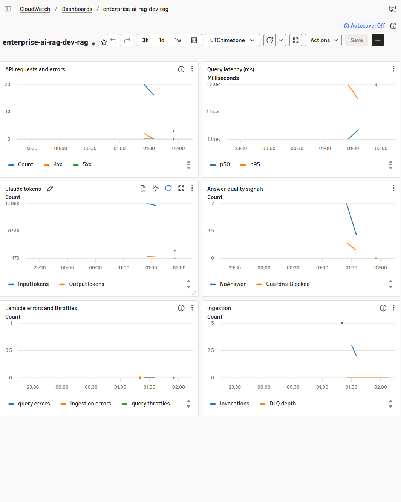
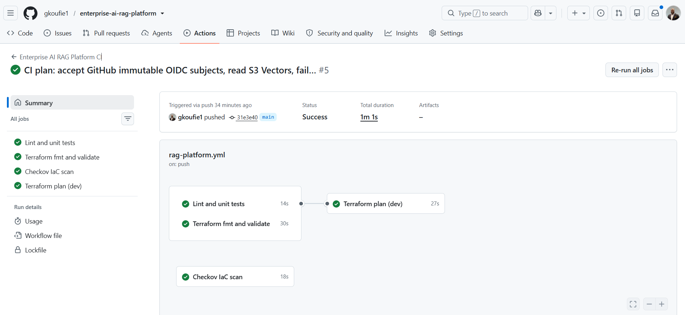
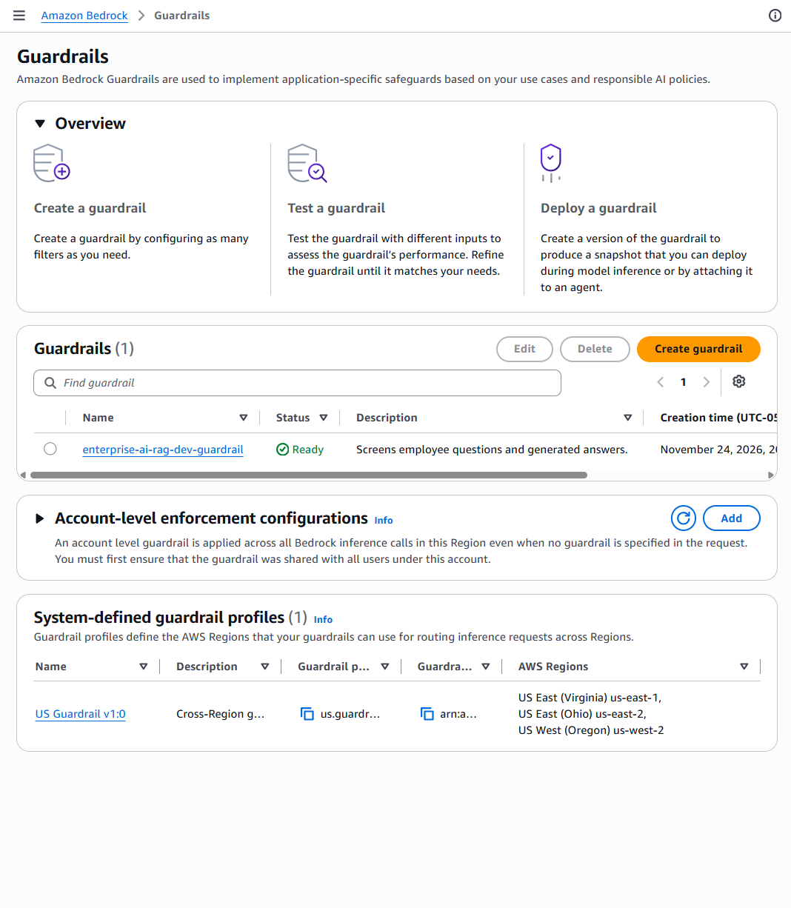
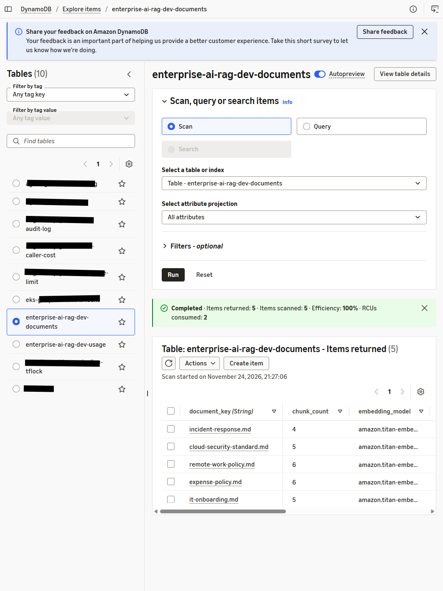
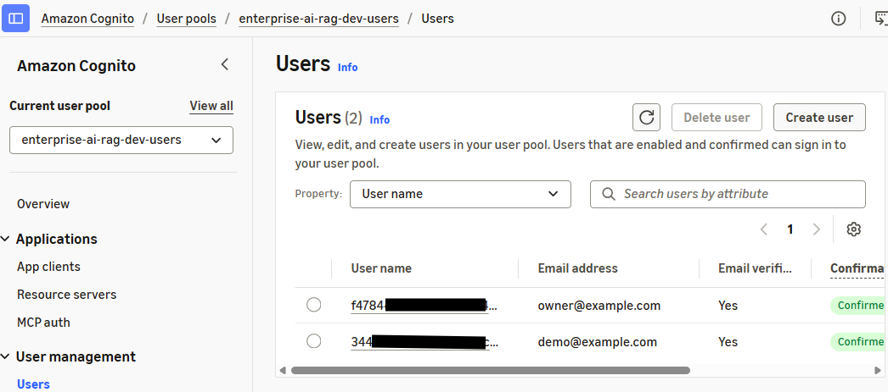
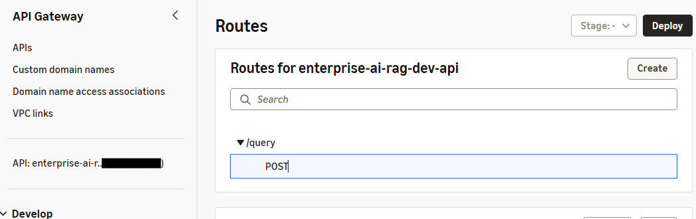
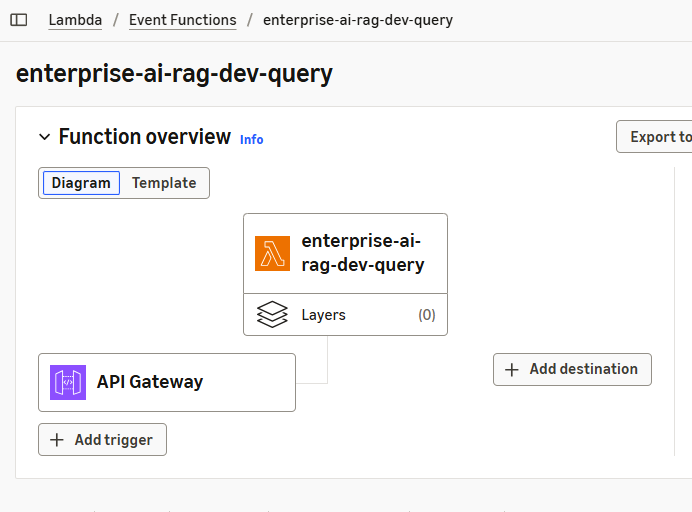

# Enterprise AI Knowledge Assistant on AWS

An AI assistant that answers employees' questions using only the company's own documents, and shows the exact sentence each answer came from. It runs entirely on AWS, costs almost nothing when idle, and is built, tested and deployed with code.


**Try it live:** https://d1oaspqgya82kd.cloudfront.net. A demo login is shown on the sign-in page; it allows 30 questions a day.



---

## The project in 30 seconds

**The problem.** In most companies, policies, guides and procedures are scattered across shared drives and wikis. Employees waste time searching, support teams answer the same questions again and again, and general chatbots like ChatGPT can't help because they have never seen the company's documents. When they guess, they guess wrong.

**The solution.** I built an assistant that:

1. **Reads the company's documents** automatically whenever one is added, changed or deleted.
2. **Finds the right passage** when an employee asks a question, by meaning rather than exact keywords.
3. **Writes a short answer** using Claude (Anthropic's AI model) on Amazon Bedrock, from those passages only.
4. **Shows its source**, quoting the exact sentence it used, so anyone can check it.
5. **Says "I couldn't find that"** instead of making something up when the documents don't cover the question.

**Why it matters.** This pattern is called RAG (retrieval-augmented generation). It's one of the most common ways companies put AI to work on their own data, because it keeps answers accurate, verifiable and private.

## What this project shows I can do

| Skill | Where it shows up in this project |
|---|---|
| **Cloud architecture (AWS)** | 12 AWS services working together, chosen for low cost and no servers to manage |
| **Infrastructure as code (Terraform)** | Every resource is written as code in 10 reusable modules: about 70 resources, created or removed with one command |
| **Generative AI engineering** | Document search, AI answers with citations, safety filters, and a test set that measures answer quality |
| **Security** | Login required, least-privilege permissions, encryption everywhere, AI safety filters, usage limits |
| **DevOps / CI/CD** | Every code change is automatically tested, checked for security problems, and previewed against the real AWS account, without storing passwords in GitHub |
| **Monitoring and operations** | Live dashboard, email alerts, tracing, and a safety net for failed uploads |
| **Problem solving** | Measured accuracy, found why 3 of 15 test questions failed, fixed it, and reached 15 of 15 (details below) |
| **Cost awareness** | Close to $0/month when idle and about a third of a cent per question |

## How it works, in plain English



**Adding documents.** When someone uploads a document, the system splits it into sections, one per heading, such as "Equipment and security". It then turns each section into a "meaning fingerprint" (an *embedding*): a list of numbers that captures what the text is about. Sections about similar topics get similar fingerprints. They are stored in a searchable library (a *vector database*). If a document is edited or deleted, the library updates automatically.

**Asking a question.** The employee signs in on the website and types a question. The question goes through a safety filter that blocks harmful requests and attempts to trick the AI. Then the question gets its own fingerprint and the system finds the sections whose fingerprints are closest. If nothing is close enough, it replies "I couldn't find that" and never calls the AI, which prevents made-up answers and saves money. Otherwise Claude writes a short answer using only those sections and marks which sentence supports each claim. The answer goes through the safety filter once more before the employee sees it.

**Keeping it running.** A dashboard shows traffic, speed, AI usage and how often questions go unanswered. Alerts fire if something breaks, and failed uploads are kept in a queue instead of silently lost.

## Results

I wrote 15 test questions with known correct answers: 12 that the documents can answer, 2 they can't (the system should say so), and 1 attempt to trick the AI (it should be blocked). The script `eval/run_eval.py` runs them against the live system and scores them.

| Version | Passed | Found the right document | Cited it correctly | Answer had the key facts |
|---|---|---|---|---|
| First version | 12 / 15 | 9 / 12 | 9 / 12 | 9 / 12 |
| **After the fix** | **15 / 15** | **12 / 12** | **12 / 12** | **12 / 12** |

**What went wrong, and the fix.** Each short document was stored as one big block, so a narrow question like "How long do we keep audit logs?" was a weak match for a document covering five different topics, and the search picked the wrong document. I changed the system to split documents at their headings, so each topic gets its own fingerprint. That fixed all three failures, while unanswerable questions were still correctly declined.

Testing on the live system also caught a safety filter that was too strict: it blocked the normal question "Can I use my personal laptop for customer data?" as rule-breaking. I tuned that filter and kept the others strict. Answers take about 1.5 seconds.

## Screenshots

| | |
|---|---|
| <br>*Sign-in page with the demo login* | <br>*Monitoring dashboard: traffic, speed, AI usage, unanswered and blocked questions* |
| <br>*Automated checks on every code change, all passing* | <br>*AI safety filter (Bedrock Guardrails)* |
| <br>*Document registry: each document and how many sections it was split into* | <br>*User accounts: an owner and a rate-limited demo account* |
| <br>*The single, login-protected API endpoint* | <br>*The function that answers questions* |

## What it's built with

| Job | AWS service or tool | In plain words |
|---|---|---|
| Website | Amazon S3 + CloudFront | Hosts the chat page securely over HTTPS, worldwide |
| Sign-in | Amazon Cognito | Login page and user accounts; only invited users get in |
| Front door for questions | Amazon API Gateway | Checks the login and limits how fast requests can arrive |
| The "brains" | AWS Lambda (Python) | Small programs that run only when needed: one answers questions, one processes documents |
| Document storage | Amazon S3 | Where documents are uploaded; versioned and encrypted |
| Meaning fingerprints | Amazon Titan Text Embeddings (Bedrock) | Turns text into searchable fingerprints |
| Searchable library | Amazon S3 Vectors | Stores fingerprints and finds the closest matches, with no always-on server cost |
| Writing answers | Claude on Amazon Bedrock | Anthropic's AI model writes the answer and cites its sources |
| Safety | Amazon Bedrock Guardrails | Blocks harmful content, trick attempts and sensitive data such as card numbers |
| Bookkeeping | Amazon DynamoDB | Tracks which documents are indexed, and counts demo questions per day |
| Monitoring | CloudWatch, X-Ray, SNS | Dashboard, alerts by email, and request tracing |
| Infrastructure as code | Terraform | Every AWS resource above, written as code |
| Automation | GitHub Actions | Tests, security scan and a deployment preview on every change |

**About the AI model.** The project runs on **Claude Haiku 4.5**, a fast and inexpensive model that is very good at short answers grounded in documents. It's built to switch to **Claude Opus 5.5** by changing one setting. AWS enables its newest models per account based on account history; my account wasn't eligible yet, so I made the model configurable instead of waiting.

## Security, in plain words

- **You must sign in** to ask anything. Self sign-up is off, so an administrator creates every account.
- **Least privilege:** each part of the system can touch only the exact resources it needs, nothing more.
- **Encrypted everywhere:** data is encrypted when stored and when sent, and storage buckets refuse unencrypted connections.
- **AI safety filters** check both the question and the answer.
- **The AI is told to treat documents as information, not instructions,** so a document can't hijack it.
- **Cost protection:** traffic is rate-limited, questions are capped at 1,000 characters, and the public demo account is limited to 30 questions a day.
- **The website** sends strict browser security headers, and the demo account can't change its own password.
- **No passwords in GitHub:** the automated checks sign in to AWS with short-lived credentials (OIDC).

## Cost

| Item | Cost |
|---|---|
| Running with no traffic | About $0 per month (everything is pay-per-use and within free allowances) |
| Each question answered | About $0.003 |
| Questions with no matching documents | Almost $0 (the AI is never called) |
| Worst case for the public demo (30 questions every day) | About $3 per month |

---

## Commands

Every command you need to run, use and maintain the project, with what it does. Run them from the project folder in a Bash terminal (Git Bash on Windows) unless a step says otherwise.

### One-time setup

**What you need installed:** an AWS account, the [AWS CLI](https://aws.amazon.com/cli/) signed in with admin rights, [Terraform](https://developer.hashicorp.com/terraform/install) 1.10 or later, and Python 3.13 or later.

```bash
aws sts get-caller-identity
```
Shows which AWS account and user you're signed in as. Run it first to be sure you're deploying to the right account.

```bash
cd terraform/bootstrap
terraform init
terraform apply -var="github_repository=gkoufie1/enterprise-ai-rag-platform" -var="create_github_oidc_provider=false"
cd ../..
```
Creates two things, once per AWS account: an S3 bucket that stores Terraform's record of everything it built (the *state*), and a read-only role that GitHub uses to preview changes. Use `create_github_oidc_provider=true` if your account has never been connected to GitHub Actions before. Keep the `terraform.tfstate` file this creates; it isn't in git.

### Build and deploy

```bash
bash scripts/build_lambdas.sh
```
Packages the Python code and its libraries into the two Lambda functions, ready to upload. Re-run it whenever you change anything in `app/`.

```bash
cd terraform/environments/dev
cp backend.hcl.example backend.hcl
cp terraform.tfvars.example terraform.tfvars
```
Creates your two private settings files (both are git-ignored). In `backend.hcl`, set the state bucket name from the bootstrap step. In `terraform.tfvars`, set your options, such as the alert email and the demo login text.

```bash
terraform init -backend-config=backend.hcl
```
Prepares Terraform: downloads the AWS plugin and connects to the state bucket. Needed once, or after changing `backend.hcl`.

```bash
terraform plan -out=tfplan
```
Shows exactly what Terraform will create, change or delete, without touching anything. Always read this before applying.

```bash
terraform apply tfplan
```
Builds or updates everything on AWS to match the code: about 60 resources on the first run, taking roughly 5 minutes (mostly CloudFront).

```bash
terraform output
```
Prints the important addresses: the website URL, the API URL, bucket names, the user pool ID and the dashboard link.

```bash
cd ../../..
```
Returns to the project folder for the commands below.

### Load documents and create users

```bash
bash scripts/upload_docs.sh
```
Uploads everything in `sample-docs/` to the documents bucket. Each upload automatically triggers processing; files you deleted locally are removed from the library too. Pass a folder to upload your own documents: `bash scripts/upload_docs.sh path/to/folder`.

```bash
export RAG_PASSWORD='Choose-a-Strong-Passw0rd!'
bash scripts/create_user.sh you@example.com
```
Creates a login with no daily limit. The password is read from `RAG_PASSWORD` so it doesn't end up in your command history. It needs 12+ characters with upper and lower case, a number and a symbol.

```bash
export RAG_PASSWORD='Demo-Passw0rd-2026!'
bash scripts/create_user.sh demo@example.com demo
```
Creates the public demo login. The word `demo` puts it in the demo group, which is limited to 30 questions a day. To show it on the sign-in page, set `demo_login_hint` in `terraform.tfvars` and run `terraform apply` again.

### Use it

Open the website from `terraform output -raw frontend_url` (run inside `terraform/environments/dev`), choose **Sign in**, and ask a question. To use it from the terminal instead:

```bash
export RAG_TOKEN="$(bash scripts/get_token.sh you@example.com)"
```
Signs in and saves a temporary access pass (a token, valid for one hour) for the commands below. It uses the password in `RAG_PASSWORD`.

```bash
bash scripts/query_api.sh "Can I use my personal laptop for customer data when working remotely?"
```
Asks a question and prints the full response: the answer, the quoted sources, which model answered, and how many questions the account has left today.

### Check quality

```bash
pip install -r requirements-dev.txt
```
Installs the tools for testing and code checks.

```bash
pytest
```
Runs 38 automated tests in a few seconds. They use stand-ins for AWS and the AI, so they cost nothing and need no internet.

```bash
ruff check . && ruff format --check .
```
Checks the Python code for errors and consistent formatting.

```bash
export RAG_API_URL="$(terraform -chdir=terraform/environments/dev output -raw query_api_url)"
python eval/run_eval.py
```
Runs the 15 test questions against the live system and prints a pass/fail table with accuracy scores. It costs about 5 cents. Re-run it after any change to how documents are split or searched, or to the model.

### Look after it

```bash
MSYS_NO_PATHCONV=1 aws logs tail /aws/lambda/enterprise-ai-rag-dev-ingestion --follow
```
Shows document-processing logs live: useful right after uploading. Swap `ingestion` for `query` to watch questions being answered. (`MSYS_NO_PATHCONV=1` stops Git Bash on Windows from mangling the `/aws/...` path; it does nothing elsewhere.)

```bash
bash scripts/reingest.sh remote-work-policy.md
```
Re-processes one document by hand, for example after a "failed upload" alert. Normally you never need it, because uploads are processed automatically.

```bash
aws sqs get-queue-attributes --queue-url "$(terraform -chdir=terraform/environments/dev output -raw ingestion_dlq_url)" --attribute-names ApproximateNumberOfMessages
```
Counts uploads that failed even after retries and are waiting in the safety-net queue. It should be 0.

```bash
aws ce get-cost-and-usage --time-period Start=2026-11-01,End=2026-11-30 --granularity MONTHLY --metrics UnblendedCost --group-by Type=DIMENSION,Key=SERVICE
```
Shows this month's AWS cost per service. Change the dates to the current month. Cost data can lag by up to a day.

### Change the AI model

In `terraform/environments/dev/terraform.tfvars`, add:

```hcl
claude_endpoint   = "mantle"
claude_model_id   = "anthropic.claude-opus-5-5"
fallback_model_id = "anthropic.claude-opus-4-8"
```

Then run `terraform apply` in that folder. This switches from Claude Haiku 4.5 to Claude Opus 5.5, once AWS has enabled Opus for your account. Permissions update automatically. Delete the three lines and apply again to switch back.

### Remove everything

```bash
cd terraform/environments/dev
terraform destroy
```
Deletes every AWS resource the project created, so it stops costing anything. It asks for confirmation first. Set `force_destroy = true` in `terraform.tfvars` and apply before destroying if the buckets still hold files. The state bucket from the bootstrap step is protected from deletion on purpose.

---

## Project layout

```
frontend/        the chat website (HTML, CSS, JavaScript; no build step)
app/
  ingestion/     processes uploaded documents
  query/         answers questions
  rag_core/      shared code: splitting documents, fingerprints
terraform/
  bootstrap/     one-time setup: state bucket and GitHub access role
  environments/  the dev environment, which wires the modules together
  modules/       10 reusable building blocks (website, login, API, storage, ...)
tests/           38 automated tests
eval/            15 test questions and the scoring script
scripts/         helper commands (build, upload, create user, ask a question, ...)
sample-docs/     five made-up company documents to try it with
docs/            architecture notes, interview guide, video script, screenshots
```

## Want more detail?

- [docs/ARCHITECTURE.md](docs/ARCHITECTURE.md): data model, permission matrix, failure handling and tuning settings.
- [docs/INTERVIEW_EXPLANATION.md](docs/INTERVIEW_EXPLANATION.md): how to explain the project, and answers to common interview questions.
- [docs/YOUTUBE_WALKTHROUGH.md](docs/YOUTUBE_WALKTHROUGH.md): script for a video demo.
